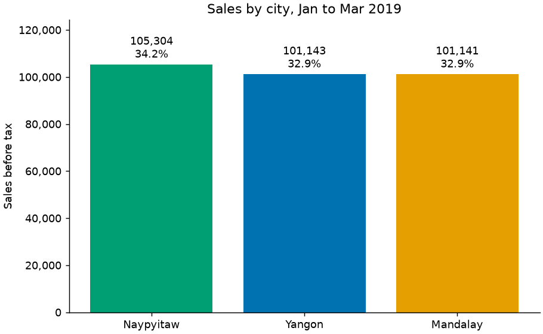
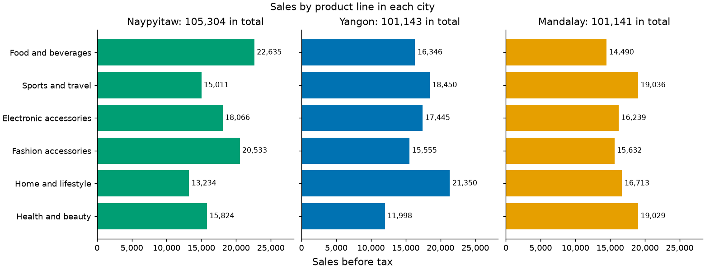
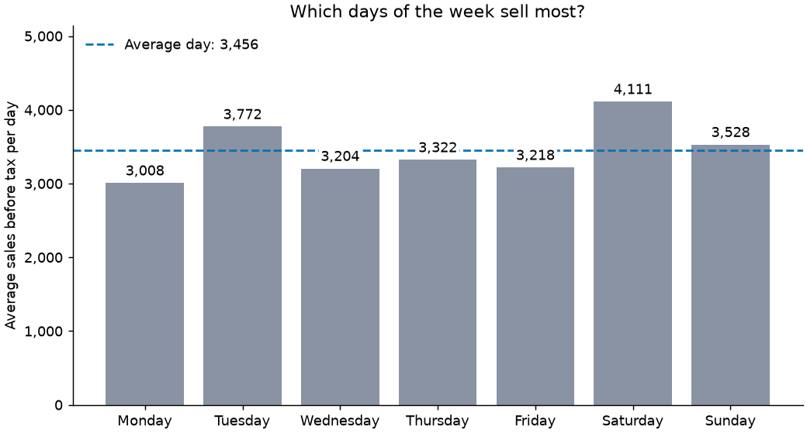
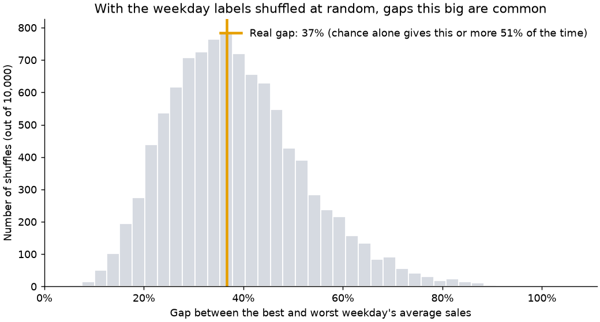
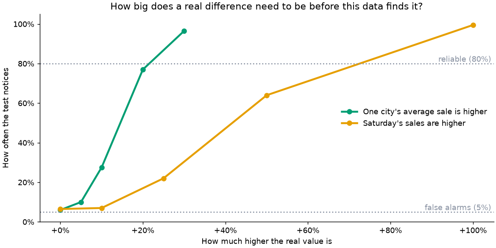

# Market Sales Analysis

[](https://github.com/Kishore-1011/Market-Sales-Analysis/actions/workflows/notebook.yml)


An analysis of 1,000 supermarket sales across three branches: how much each sold, what customers bought, and whether any of the differences are real.

> **This is sample data.** The sales are a widely shared practice dataset, not records from a real shop. The analysis shows how to explore and test sales data, and its findings shouldn't be read as facts about real customers.

## The short version

**None of the differences is large enough to call real.** Naypyitaw sells 4.1% more than the lowest city, Saturday averages 37% more than Monday, and 19:00 is the busiest hour. But all 22 questions tested came back "no evidence of a difference" once the tests were adjusted for asking so many. The tests can reliably find a gap of roughly a fifth between cities, so the cities really do look alike, while smaller weekday and hour effects can't be ruled out.

**Read the full story in the [report](reports/report.md)**, or follow the steps in the [notebooks](#run-it).

## What the analysis shows

"Sales" means the price before the 5% tax. All the charts are drawn from the cleaned data by [`market_sales/charts.py`](market_sales/charts.py), and the full walkthrough is in [`03_sales_analysis.ipynb`](notebooks/03_sales_analysis.ipynb).



The three cities are close: the top one is only 4.1% ahead of the lowest. Each city's strongest product line differs, though:



The biggest differences are in *when* people shop. Saturday averages 37% more than Monday, and 19:00 is the busiest hour:



These are descriptions, not conclusions. Whether a difference is bigger than chance is tested in the next section. And because the data is sample data, none of it says anything about real shoppers.

## Are the differences real?

Every claim above is tested in [`04_testing_findings.ipynb`](notebooks/04_testing_findings.ipynb) with 22 statistical tests ([full results](reports/statistical_tests.csv)). The p-values are adjusted for running so many tests at once, because with 22 tests about one would look significant by luck alone.

**None of the 22 differences is real.** The cities, product lines, customer types and payment methods can't be told apart, and Saturday's 37% lead over Monday is the sort of gap that shuffling the weekday labels at random produces 51% of the time:



A finding of "nothing" only means something if the tests would have noticed a real difference, so this was checked by planting known differences in the data. With nothing planted the tests raised a false alarm between 4% and 7% of the time, close to the 5% they should, and a real 20% to 30% difference between cities was found. But a Saturday boost has to reach roughly +70% before it's found reliably, because there are only 12 or 13 of each weekday in 89 days:



So the honest reading is that no pattern is *proven*, and that small weekday or hour effects can't be ruled out with this much data. Sample data like this, with prices, quantities and ratings spread almost evenly, is often free of patterns. With real data the same code would be able to find them.

## The data

[`data/raw/supermarket_sales.csv`](data/raw/supermarket_sales.csv) has one row per sale, from 1 January to 30 March 2019, at three branches (Yangon, Mandalay and Naypyitaw).

| Column | Meaning |
|---|---|
| `Invoice ID`, `Branch`, `City` | The sale and where it happened |
| `Customer type`, `Gender` | Who bought |
| `Product line` | What kind of product |
| `Unit price`, `Quantity` | Price of one item, and how many were bought |
| `Tax 5%`, `Total` | Tax on the sale, and the total paid |
| `Date`, `Time`, `Payment` | When and how it was paid |
| `Rating` | The customer's rating, from 4 to 10 |
| `cogs`, `gross income`, `gross margin percentage` | Derived from the columns above. `cogs` is really the price before tax, `gross income` is just the tax, and the margin never changes, so cleaning renames or drops them (see the [data dictionary](docs/data_dictionary.md)) |

## Run it

```bash
python -m venv .venv
.venv\Scripts\activate          # macOS/Linux: source .venv/bin/activate
pip install -r requirements-dev.txt

python -m market_sales.clean    # clean the raw data into data/processed/
python -m market_sales.charts   # redraw the charts in reports/figures/
python -m market_sales.stats    # rerun the statistical tests
pytest                          # check the cleaning, the statistics and the charts
ruff check market_sales tests   # check the code style
```

Then open a notebook in Jupyter or VS Code. They work whether you start from the project folder or the `notebooks` folder:

- [`01_market_sales_exploration.ipynb`](notebooks/01_market_sales_exploration.ipynb): the original first look at the data
- [`02_data_cleaning.ipynb`](notebooks/02_data_cleaning.ipynb): how the raw file is cleaned and checked
- [`03_sales_analysis.ipynb`](notebooks/03_sales_analysis.ipynb): sales by city, product, time and customer
- [`04_testing_findings.ipynb`](notebooks/04_testing_findings.ipynb): which differences are real, and what the data can and can't show

## Data quality

Cleaning never drops or changes anything quietly:

- Columns are only removed after the code proves they carry no extra information.
- Every rule the data should follow is checked: no missing values, unique invoice IDs, each branch in one city, sensible quantities, prices and ratings, and `subtotal + tax = total`.
- If any rule breaks, cleaning stops with a message naming every problem. Unreadable dates name the spreadsheet row.
- A test fails if the saved cleaned file is out of date with the cleaning code.

## Project structure

```
Market-Sales-Analysis/
├── market_sales/              # Reusable code
│   ├── config.py              # Paths and fixed values
│   ├── cleaning.py            # Cleaning rules and data checks
│   ├── clean.py               # python -m market_sales.clean
│   ├── analysis.py            # Sales questions, answered as tables
│   ├── stats.py               # Statistical tests, and checks that they work
│   └── charts.py              # The charts
├── data/
│   ├── raw/                   # The original CSV, never edited
│   └── processed/             # The cleaned data
├── notebooks/                 # The analysis
├── docs/data_dictionary.md    # What every column means
├── tests/                     # Automated tests
├── reports/
│   ├── report.md              # The whole story in one page
│   ├── figures/               # The charts
│   └── statistical_tests.csv  # Results of every test
├── requirements.txt           # Libraries the analysis needs
└── requirements-dev.txt       # Plus what's needed to run notebooks and tests
```

## Roadmap

This project is being improved in stages:

1. **Run anywhere:** folders, relative paths, pinned libraries and this README *(done)*
2. **Clean the data:** real timestamps, honest column names and automatic checks *(done)*
3. **Better questions:** sales in money, by city, product, time and customer, with one set of reusable charts *(done)*
4. **Test the findings:** 22 tests with adjusted p-values, and a check that the tests can find real differences *(done)*
5. **Presentation:** a written report, a README that leads with the conclusion, and a code style check *(done)*
6. **Dashboard:** an interactive page with filters

## License

[MIT](LICENSE)
