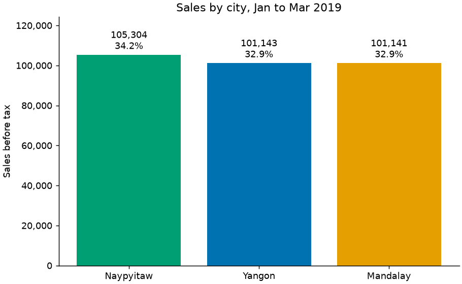
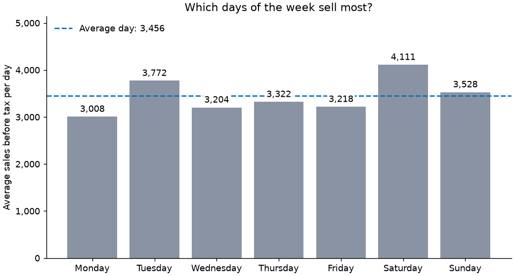
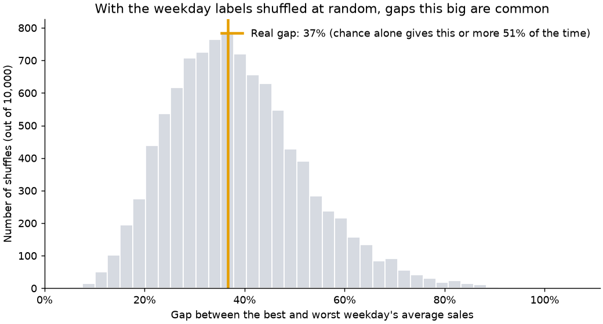
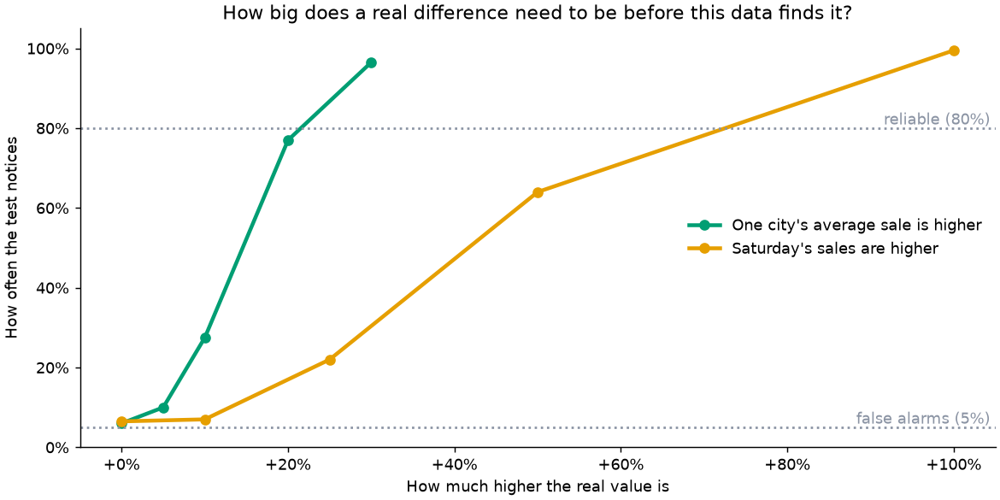

# Market Sales Analysis: report

**Data:** 1,000 sales at three branches (Yangon, Mandalay, Naypyitaw), 1 January to 30 March 2019 (89 days). This is a widely shared practice dataset, not records from a real shop, so the findings describe this file and say nothing about real customers.

"Sales" means the price before the 5% tax. The data has no costs, so profit can't be measured, and it doesn't state a currency.

## The conclusion

**No difference in the data is large enough to be called real.** Of 22 questions tested, none passed once the tests were adjusted for asking so many questions. The data looks like evenly spread sample data: prices, quantities and ratings show almost no relationships.

That doesn't prove the shops are identical. The tests can reliably find a gap of roughly a fifth between cities, but only a very large weekday effect, so smaller weekday and hour effects can't be ruled out.

## What the sales look like

The 1,000 sales total 307,587 (3,456 a day). The median sale is 242, the average 308, and the average rating 6.97.

| City | Sales | Share |
|---|---:|---:|
| Naypyitaw | 105,304 | 34.2% |
| Yangon | 101,143 | 32.9% |
| Mandalay | 101,141 | 32.9% |

- **Cities:** the top city is 4.1% ahead of the lowest.
- **Products:** Food and beverages is the top line with 17.4% of sales, and Health and beauty is the lowest with 15.2%, a gap of 14.1%.
- **Days:** Saturday averages 4,111 a day against 3,008 on Monday, 37% more.
- **Hours:** 19:00 is the busiest hour with 12.3% of sales, and 13:00 follows with 10.8%.

## Are these differences real?

Each of the 22 questions was tested with a method suited to it (chi-square, Kruskal-Wallis, Mann-Whitney, Spearman, and shuffling tests for "best versus worst" gaps). Because 22 tests will turn up about one apparent result by luck, the p-values were adjusted with Holm's method. The full table is in [statistical_tests.csv](statistical_tests.csv).

| Verdict | Questions |
|---|---:|
| Real difference | 0 |
| Possible, not convincing | 0 |
| No evidence of a difference | 22 |

The closest calls, before adjusting:

| Question | p-value |
|---|---:|
| Are some hours of the day busier than others? | 0.050 |
| Do weekend days sell more than weekdays? | 0.052 |
| Do women and men spend differently per sale? | 0.101 |
| Do customers rate the cities differently? | 0.130 |

After adjusting, every one of them is 1.0.

Saturday's lead over Monday is the kind of gap that appears about 51% of the time when the weekday labels are shuffled at random, so it isn't evidence of a weekday pattern:

Likewise, 19:00 being the busiest hour isn't supported: a best-versus-worst hour gap this large appears about 31% of the time by chance.

## Could the tests have found anything?

To find out, known differences were planted in the data and the tests rerun 200 times for each size.

- With nothing planted, the tests raised a false alarm between 4% and 7% of the time, close to the 5% they should.
- A planted boost to one city's average sale was noticed 28% of the time at +10%, 77% at +20% and 96% at +30%.
- A planted Saturday boost was noticed 22% of the time at +25%, 64% at +50%, and almost always at +100%. It takes roughly +70% to be found reliably, because there are only 12 or 13 of each weekday in 89 days.

The smallest gap each comparison could reliably find, as a share of the average:

| Comparison | Smallest gap reliably found |
|---|---:|
| One city against another | 16.5% |
| Members against other customers | 13.5% |
| Women against men | 13.5% |
| Weekend against weekdays | 27.8% |
| One weekday against another | 46.8% |

## What we can and can't say

**We can say**

- The three cities are indistinguishable on sales, average sale and rating. A difference of 20% to 30% would usually have been found, and none was.
- Members, non-members, women, men and the payment methods all look alike.
- The product mix doesn't clearly differ between cities, even though each city's top line is different.

**We can't say**

- That Saturday isn't a better day. A real effect smaller than about +70% could be hiding.
- That every hour is equally busy. The uneven-hours test landed right on the edge (p = 0.050 before adjusting), so it's worth rechecking with more data. It does not show that 19:00 in particular is the best hour.
- Anything about profit, or about real shoppers.

"Not significant" is not the same as "no difference". It means this data doesn't show one.

## How it was done

- Cleaning stops with a clear message if any rule breaks (missing values, duplicate invoices, a branch in two cities, `subtotal + tax = total`), and never changes data quietly. Details are in the [data dictionary](../docs/data_dictionary.md).
- Every number above comes from the code in [`market_sales/`](../market_sales), is covered by automated tests, and can be reproduced with the commands in the [README](../README.md).
- The steps are explained in notebooks [2](../notebooks/02_data_cleaning.ipynb), [3](../notebooks/03_sales_analysis.ipynb) and [4](../notebooks/04_testing_findings.ipynb).
